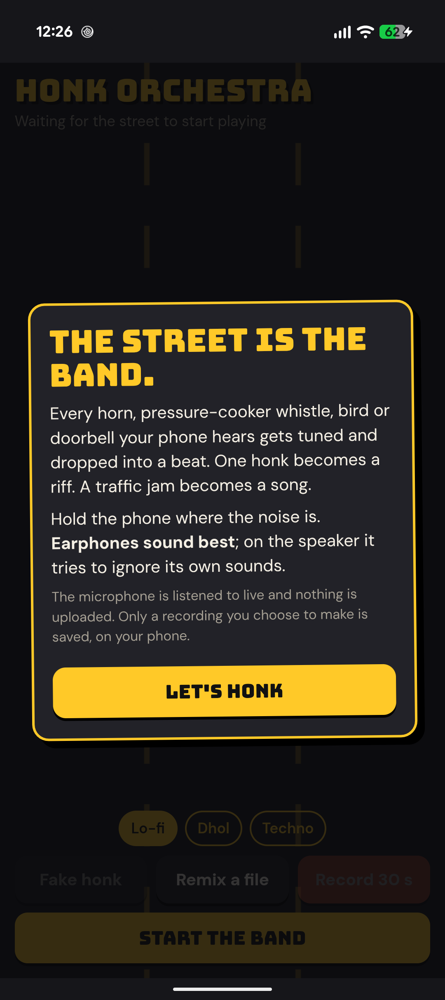

# Honk Orchestra

**The street is the band.** Honk Orchestra listens to the world around you and turns every horn,
pressure-cooker whistle, bird chirp and doorbell into music, live. Your first honk sets the key, each
sound gets tuned and dropped into a beat, and one honk becomes a little riff. A traffic jam becomes a song.

**Play it now:** https://mark-alexander-hub.github.io/honk-orchestra/ (any phone or laptop, nothing to install)

<p align="center">
  <a href="https://apps.obtainium.imranr.dev/redirect?r=obtainium://add/https://github.com/mark-alexander-hub/honk-orchestra"></a>
  <a href="https://github.com/mark-alexander-hub/honk-orchestra/releases/latest"></a>
</p>

<p align="center">
  
  
</p>

## What it does

- **Listens for tonal sounds**: horns, whistles, chirps, bells, humming. Talking, claps and traffic
  rumble don't have a clear pitch, so they pass through.
- **Tunes them** to the key set by the first honk and plays them back on the beat as a short riff
  (each honk repeats up the scale a few times, then fades out).
- **Three bands:** Lo-fi, Dhol and Techno.
- **Remix a file:** pick any recording or video on your phone and the band plays along with it.
- **Record 30 s** and share the remix. A little of the real street goes into the recording for atmosphere.
- **Fake honk** for trying it at a quiet desk.

On a phone speaker it ignores its own notes and drums, so it doesn't feed back on itself. Earphones
sound best.

## The app

The Android app is the same page, with the screen kept awake and recordings saved to
**Downloads/Honk Orchestra** and shared straight to WhatsApp. Install it with Obtainium (badge above)
or download the APK from Releases. Android 8 and newer.

## Privacy

The microphone is analysed live, a twentieth of a second at a time, and nothing is uploaded. The page
has no analytics and no server. Only a recording you choose to make is saved, on your phone. The only
thing fetched from the internet is the font.

## How it hears a honk

Every 21 ms it takes a 4096-point FFT and compares it with a slowly learned picture of the street's
background noise. A honk is a narrow peak far above that background, the lowest of its overtones (voices
have a strong partner at half their pitch; horns don't), holding the same pitch for about a tenth of a
second. The captured snippet is resampled to the nearest note of the scale. Everything is plain Web Audio
in one `index.html`; no libraries.

## Build the app

```
cd android
gradlew assembleDebug
```

The build copies `index.html` into the app, so the website and the app are always the same.

## Licence

MIT. Built by Mark Isidore Nicholas Alexander.
