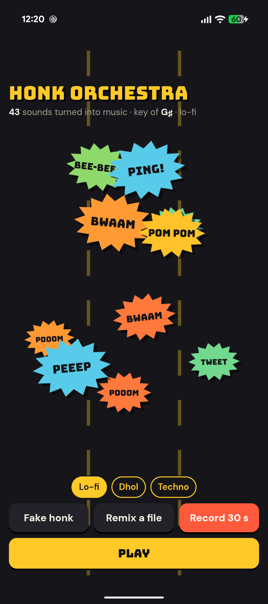
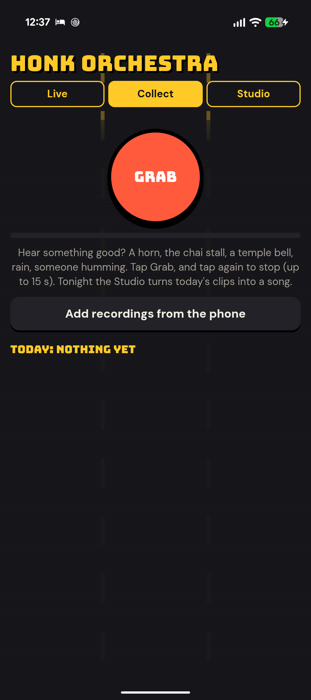
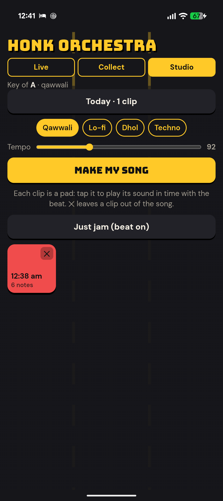
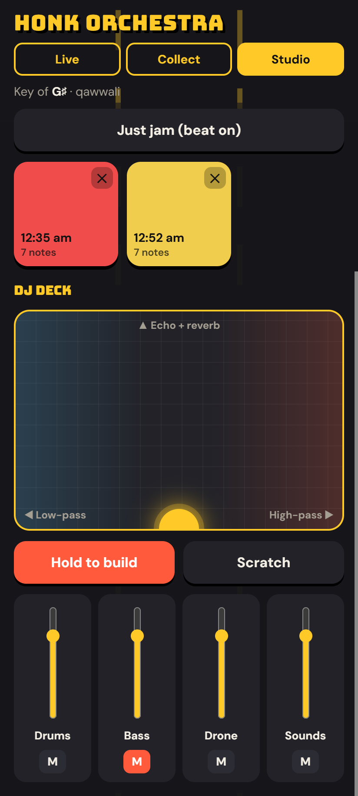

# Honk Orchestra

**The street is the band.** Honk Orchestra listens to the world around you and turns every horn,
pressure-cooker whistle, bird chirp and doorbell into music, live. Your first honk sets the key, each
sound gets tuned and dropped into a beat, and one honk becomes a little riff. A traffic jam becomes a song.

**Play it now:** https://mark-alexander-hub.github.io/honk-orchestra/ (any phone or laptop, nothing to install)

<p align="center">
  <a href="https://apps.obtainium.imranr.dev/redirect?r=obtainium://add/https://github.com/mark-alexander-hub/honk-orchestra"></a>
  <a href="https://github.com/mark-alexander-hub/honk-orchestra/releases/latest"></a>
</p>

<p align="center">
    
  
  
  
</p>

## Day Mix: collect your day, get a song tonight

- **Collect:** tap **Grab** whenever you hear something good (a horn, the chai stall, a temple bell, rain,
  someone humming) and it keeps a clip of up to 15 seconds on your phone. You can also add recordings
  you already have.
- **Studio:** at night, pick a day and a style and tap **Make my song**. It finds the notes in every clip
  and arranges about a minute of music: the day's sounds over a drone, the beat coming in, full swing,
  and an ending where the drums drop out and your last sound rings off. The song is saved and ready to share.
- **Qawwali** style: harmonium drone, dholak in keherwa, a crowd of hand-claps, and the tempo climbs
  through the last part the way a qawwali does.
- Each clip is also a **pad** you can tap to play its sound on the beat, and ✕ leaves a clip out.

### Voice, hum, tags and auto-grab

In Collect, pick what you're grabbing:

- **Sound** (default): horns, bells, whistles. Tag it (Horn, Chai, Temple, Bus, Rain, Bird, Office) and
  the tag shows on the pad and in the song's file name.
- **Voice:** say something ("Good morning Bangalore!"). The Studio cuts it into syllable chops and rides
  them on the beat like a DJ vocal. Tap its pad for a stutter.
- **Hum:** hum a tune. The Studio finds the notes, moves them into the song's key and plays them back
  as the lead: a plucked sitar-like string in Qawwali and Dhol, a flute in Lo-fi, a synth in Techno.
- **Auto-grab horns:** leave Collect open on the dashboard and every horn that goes by is kept as a
  3-second clip. It uses the microphone and battery while the tab is open, so it's off by default.

### Video, week mix

- **Video:** press the Video toggle next to Make my song and you get a portrait .mp4 with the bursts
  popping on the beat, ready for WhatsApp Status or a Reel (Chrome and the app; browsers without mp4
  recording give a .webm).
- **Week mix:** plays the last seven days' songs back to back, with a filter sweep between days, as one
  recording.

### The DJ deck

Under the pads in the Studio:

- **FX pad:** drag left to close a low-pass filter (the "underwater" sweep), right to open a high-pass,
  up for echo and reverb. Let go and it snaps back clean.
- **Hold to build:** the kick and bass drop out, a snare roll speeds up and a riser climbs. Let go and it
  **drops** on the next downbeat with a crash and a sub boom. Make my song does this by itself before the claps come in.
- **Scratch:** a vinyl scratch on the last sound that played.
- **Hold to repeat:** stutters the last half-beat of the whole mix for as long as you hold.
- **Mixer:** faders and mutes for Drums, Bass, Drone, Sounds and Lead.
- **Tilt FX:** lean the phone left or right to sweep the filter without touching the pad.
- **Shake the phone** to drop (or for a crash and a boom), and **tap a burst** on the Live screen to play it again.

Clips stay in the browser's storage on your phone (in the app, inside the app). Nothing is uploaded.

## Live

- **Listens for tonal sounds**: horns, whistles, chirps, bells, humming. Talking, claps and traffic
  rumble don't have a clear pitch, so they pass through.
- **Tunes them** to the key set by the first honk and plays them back on the beat as a short riff
  (each honk repeats up the scale a few times, then fades out).
- **Four bands:** Lo-fi, Dhol, Techno and Qawwali.
- **Remix a file:** pick any recording or video on your phone and the band plays along with it.
- **Record 30 s** and share the remix. A little of the real street goes into the recording for atmosphere.
- **Fake honk** for trying it at a quiet desk.

On a phone speaker it ignores its own notes and drums, so it doesn't feed back on itself. Earphones
sound best.

## The app

The Android app is the same page, with the screen kept awake and recordings saved to
**Downloads/Honk Orchestra** and shared straight to WhatsApp. Install it with Obtainium (badge above)
or download the APK from Releases. Android 8 and newer.

## Privacy

The microphone is analysed live, a twentieth of a second at a time, and nothing is uploaded. The page
has no analytics and no server. Only a recording you choose to make is saved, on your phone. The only
thing fetched from the internet is the font.

## How it hears a honk

Every 21 ms it takes a 4096-point FFT and compares it with a slowly learned picture of the street's
background noise. A honk is a narrow peak far above that background, the lowest of its overtones (voices
have a strong partner at half their pitch; horns don't), holding the same pitch for about a tenth of a
second. The captured snippet is resampled to the nearest note of the scale. Everything is plain Web Audio
in one `index.html`; no libraries.

## Build the app

```
cd android
gradlew assembleDebug
```

The build copies `index.html` into the app, so the website and the app are always the same.

## Licence

MIT. Built by Mark Isidore Nicholas Alexander.
